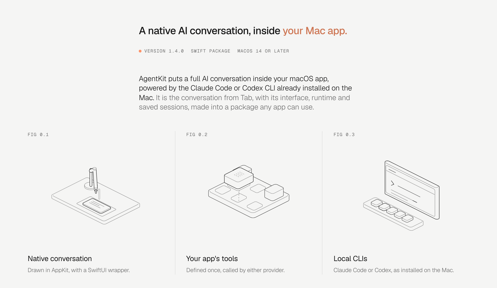

# AgentKit

### A native AI conversation, inside your Mac app.

**A Swift package that puts a full AI conversation inside your macOS app**, powered by the Claude Code or Codex CLI already installed on the Mac. It is the conversation from [Tab](https://hugocxl.github.io/tab/), with its interface, runtime and saved sessions, made into something any app can use.

[Read the docs](https://hugocxl.github.io/agentkit/docs.html) · [See the changelog](CHANGELOG.md) · [Visit the website](https://hugocxl.github.io/agentkit/)

## Built for AI-first apps

Your app describes what it can do, and the agent does it through your own tools. AgentKit brings the conversation, streaming, model selection, tool results and sessions, and the same tools work with both Claude Code and Codex.

Your app stays in charge. When it hands the agent its own tools, the provider's built-in tools are switched off or kept read-only, and every change goes through your app's own editing and undo.

## Everything a conversation needs

Streaming replies with Markdown, code, tables, math and diagrams. A composer with attachments, model and reasoning choices, approvals, questions and a prompt queue. Search, citations, subagent activity, file changes and checkpoints you can review.

Conversations and drafts are saved, so people pick up where they left off after a relaunch.

## At work in Tab and Filmatte

Tab runs its agent panes on AgentKit, and Filmatte, a native video editor, lets an agent add text and cut the timeline through the editor's own tools. The [docs](https://hugocxl.github.io/agentkit/docs.html) show how to connect it to your app, from a single window to a server that hosts many projects.

## Made to feel at home

- **Truly native.** Drawn in AppKit rather than a web view, with a SwiftUI wrapper when you need one.
- **Runs on what is already there.** The CLI and account people already use. No bundled model, no accounts to manage.
- **Try it without an account.** The example app runs an offline demo that makes no model requests.
- **Free to use.** Open source, for personal and commercial work.

## License

AgentKit is [MIT licensed](LICENSE). Code and artwork adapted from T3 Code, Pierre's icons, Simple Icons, LobeHub Icons, Devicon and iTerm2-Color-Schemes keep their own licenses, and brand marks belong to their owners. [Third-party notices](THIRD_PARTY_NOTICES.md) has the details.

Made by [Hugo](https://github.com/hugocxl), growing out of the conversation in [Tab](https://hugocxl.github.io/tab/). Ideas and contributions are welcome: [open an issue](https://github.com/hugocxl/agentkit/issues).
